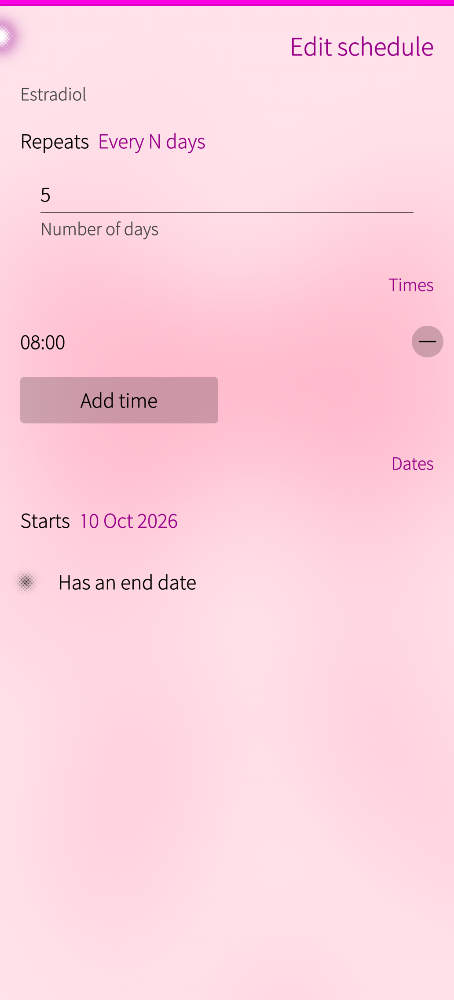

# dollfin

A native, local-first medication tracker for trans people, built for **Sailfish OS**.

Track what to take, when, whether you took it, what's left, and how your levels trend —
all on-device, no account, no cloud, no network.

Status: **planning / pre-alpha** (no app code yet).

## Principles

- **Private by default.** Data never leaves the device. The app must not request the
  `Internet` permission.
- **Reliable.** A missed reminder is a real-world harm. Reminder and schedule logic is
  treated as critical code.
- **Simple.** Smallest version that does the core job. No accounts, no sync, no telemetry,
  no dosing advice.
- **Yours, whatever you take.** Medication names are free text — no fixed drug list, so
  compounded or unusual preparations work too.
- **Open.** Free and open source, no subscriptions or premium tiers.

## Target

| Item | Value |
|------|-------|
| OS | Sailfish OS 5.x (5.1 Pispala, 5.2 Finlayson) |
| Primary device | Jolla Phone 2026 (aarch64) |
| Toolkit | Qt 5.6 QML + Sailfish Silica + C++ (Keel-grade for a future Qt 6 port) |
| Languages | English, Dutch, Norwegian |
| Distribution | OpenRepos / Storeman |
| License | GPL-3.0-or-later |

## Build

```sh
scripts/build-rpm.sh   # -> RPMS/harbour-dollfin-<version>-1.aarch64.rpm
```

Uses podman and a Sailfish Platform SDK container; no SDK install required. See
[`docs/BUILD.md`](docs/BUILD.md).

## Features

- Free-text **medications** (dropdown of common HRT meds, or “Custom”) with method, strength
  and unit
- **Schedules**: every day, every N days, or weekly on chosen weekdays, with multiple times
- **Today** screen to tick a dose taken/skipped, plus a **cover** showing today's doses
- **History** of logged doses
- **Stock** per medication with low-stock warning and a source (prescriber/pharmacy)
- **Calendar reminders** (opt-in) and **`.ics` export**
- **JSON backup** export/import
- English, Dutch and Norwegian Bokmål

## Screenshots

| Today | New medication | Schedule | History |
|-------|----------------|----------|---------|
|  |  |  |  |

## Documentation

- [`AGENTS.md`](AGENTS.md) — working instructions, conventions, definition of done
- [`docs/BUILD.md`](docs/BUILD.md) — build the RPM / install the SDK
- [`docs/PUBLISH.md`](docs/PUBLISH.md) — Storeman / OpenRepos release runbook
- [`docs/PLATFORM.md`](docs/PLATFORM.md) — researched Sailfish OS facts and sources
- [`docs/PLAN.md`](docs/PLAN.md) — product scope, architecture, phases, risks
- [`docs/TODO.md`](docs/TODO.md) — ordered task list
- [`docs/DECISIONS.md`](docs/DECISIONS.md) — decision log and open questions

## License

GPL-3.0-or-later (see `docs/DECISIONS.md` D-008). A `LICENSE` file is added before release.
